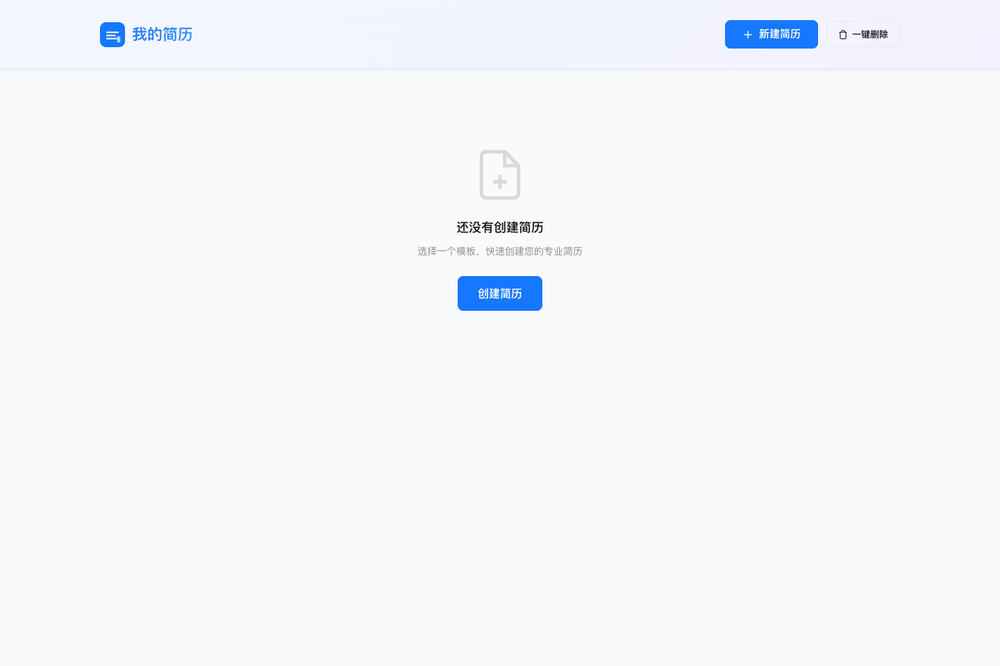
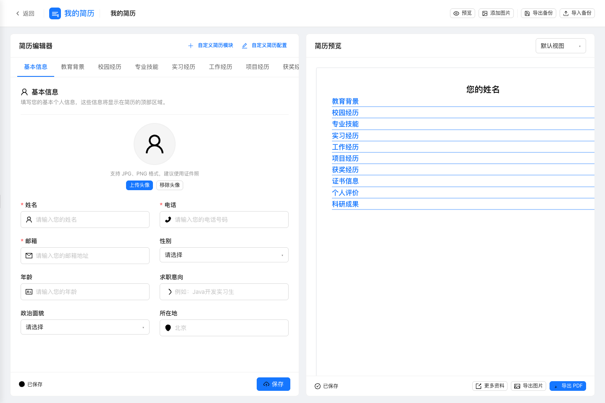

# Resume Editor · 本地简历编辑器

在浏览器里编辑、预览并导出简历。支持 **macOS 和 Windows**，无需注册账号，简历保存在当前浏览器本地。

本项目基于 [deardhp/jianli](https://gitee.com/deardhp/jianli) 整理，增加 macOS 启动入口及 Chrome / Edge 的跨平台 PDF 导出支持。原作者说明见 [上游 README](docs/UPSTREAM-README.md)。

## 界面预览

### 简历管理首页



### 简历编辑与实时预览



截图使用独立浏览器环境，不包含个人简历数据。

## 功能

- 多份简历管理，模块化编辑与实时预览。
- 字体、间距、颜色及页面布局调整。
- PDF 导出与浏览器打印。
- JSON 备份导出、导入，支持 Windows 与 Mac 之间迁移。
- 原生 HTML / CSS / JavaScript 前端，Python 本地服务，无需 Node.js。

## 下载

点击仓库上方 **Code → Download ZIP**，解压后使用。也可在 [Releases](../../releases) 下载整理好的发布包。

开发者也可以克隆：

```sh
git clone https://github.com/yanxu18712287096-rgb/resume-editor.git
cd resume-editor
```

## macOS 使用

1. 安装 [Python 3](https://www.python.org/downloads/macos/) 和 Google Chrome 或 Microsoft Edge。建议使用 Python 3.12 或更新版本。
2. 双击项目中的 **start.command**。
3. 首次启动会联网安装 Python 依赖到项目的 `.venv`，随后自动打开 **http://localhost:3000**。
4. 使用期间保留终端窗口，完成后按 **Ctrl+C** 停止服务。

如果双击无法执行，在终端进入解压后的目录运行：

```sh
bash start.command
```

终端启动不依赖文件的可执行权限。项目路径可以包含中文和空格。

## Windows 使用

1. 解压完整项目文件夹，不要单独复制启动文件。
2. 安装 Google Chrome 或 Microsoft Edge，推荐安装 Python 3.12 并勾选 **Add Python to PATH**。
3. 双击 **start.bat**。脚本调用 `run.ps1` 检查环境、安装依赖并启动前后端；未检测到 Python 时会尝试自动安装。
4. 浏览器打开 **http://localhost:3000**，按启动窗口中的提示退出。

PowerShell 启动失败时脚本会尝试使用 `start_all.py`。Windows 原启动脚本会尝试释放 3000 / 8080 端口，使用前请先退出占用这些端口的其他程序。Mac 启动器遇到端口占用则提示退出。

## 编辑、备份与跨系统迁移

1. 在首页创建简历，进入编辑器修改内容并检查右侧预览。
2. 完成后选择 PDF 导出，或使用浏览器打印保存为 PDF。
3. 定期在编辑器中选择 **导出备份**，保存生成的 `.json` 文件。
4. 在另一台 Mac / Windows 电脑启动网站，进入简历编辑器，选择 **导入备份** 并选取该 JSON 文件。

导入会替换当前打开的简历，请先备份当前内容。PDF 是阅读成品，不能代替 JSON 作为可编辑备份。浏览器数据不会自动同步；清除浏览器数据、更换浏览器或访问地址可能导致看不到原简历。两端字体不同可能改变换行或分页，导出前请检查预览。

## PDF 导出要求

后端调用本机 Chrome / Edge 的无界面模式生成 PDF，不需要上传简历到远程 PDF 服务。支持 Mac 常见应用安装路径、Windows Edge 安装路径以及 PATH 中的 Chromium 浏览器。

自定义浏览器位置可设置 `RESUME_BROWSER_PATH` 为浏览器可执行文件路径，例如 macOS：

```sh
RESUME_BROWSER_PATH="/Applications/Google Chrome.app/Contents/MacOS/Google Chrome" bash start.command
```

部分前端脚本及字体可能从 CDN 加载；首次使用建议保持联网。本项目的离线缓存不保证所有第三方资源离线可用。

## 常见问题

| 问题 | 处理方式 |
| --- | --- |
| Mac 提示找不到 Python | 安装 Python 3 后重新打开终端，运行 `python3 --version` 检查 |
| 首次安装依赖失败 | 检查网络及终端报错后重新启动；不要复制其他电脑的 `.venv` |
| 端口被占用 | 停止之前启动的网站或占用 3000 / 8080 的程序 |
| PDF 导出不可用 | 确认 Chrome / Edge 已安装；后端健康检查见 http://localhost:8080/api/health |
| 换电脑后简历不见了 | 从原电脑导出 JSON 备份，再到新电脑导入 |
| 更新后界面仍旧 | 强制刷新浏览器，必要时清理网站 Service Worker 缓存；先导出备份 |

## 项目结构

```text
start.command / start_mac.py   Mac 启动入口与服务管理
start.bat / run.ps1            Windows 启动入口
start_all.py                  Windows Python 回退启动器
index.html                    简历管理首页
resume-editor.html            编辑器
server.py                     本地前端服务（3000）
back/main.py                  PDF API（8080）
back/requirements.txt          Windows 原依赖版本
back/requirements-mac.txt      Mac 依赖范围
scripts/package.py            生成不含个人数据和运行环境的 ZIP
docs/images/                  实际界面截图
```

## 验证范围

已在 macOS 验证前端 HTTP、后端健康检查及 Chrome PDF 生成。Windows 保留上游启动流程，尚未进行 Windows 实机测试。JSON 数据格式未改动；截图为演示空白环境。

## 来源与许可

保留上游 [Apache License 2.0 文本](LICENSE) 与 [原作者使用声明](docs/UPSTREAM-README.md)。上游 README 另有“仅供个人学习交流、未经许可不得商用”的说明，与许可证文本存在表述差异；本整理版不替原作者重新解释或授权，商业使用前请向原作者确认。
